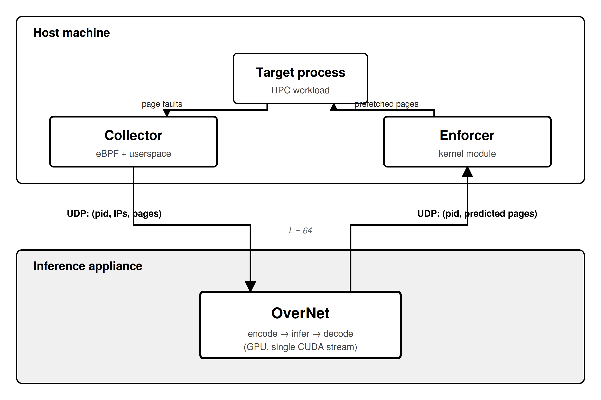
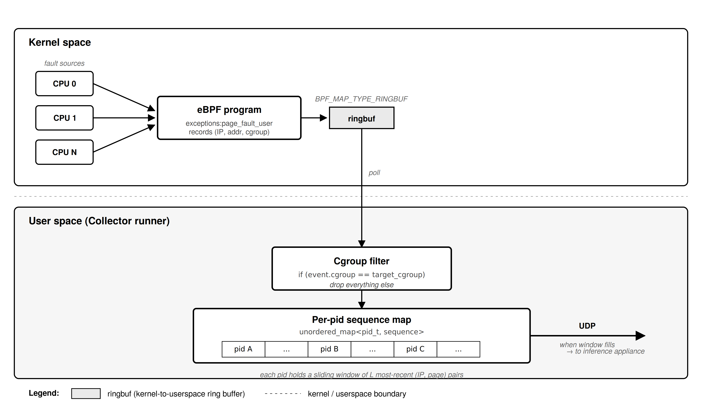
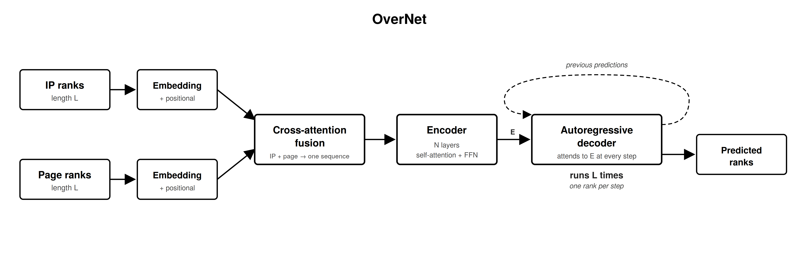
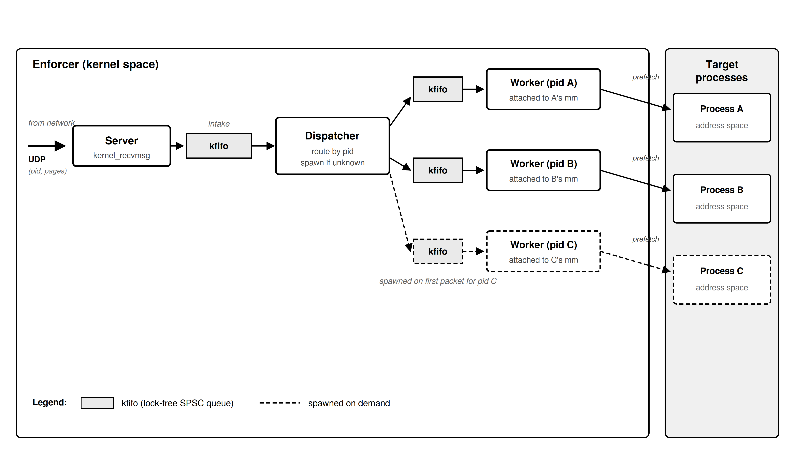
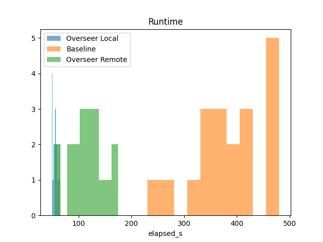
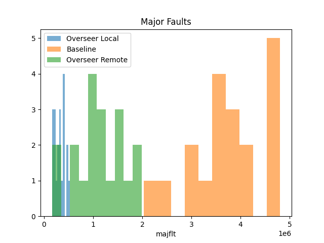
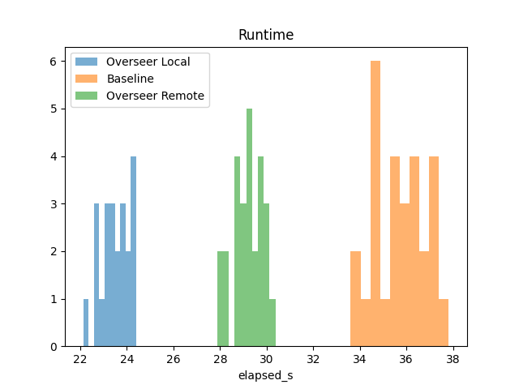
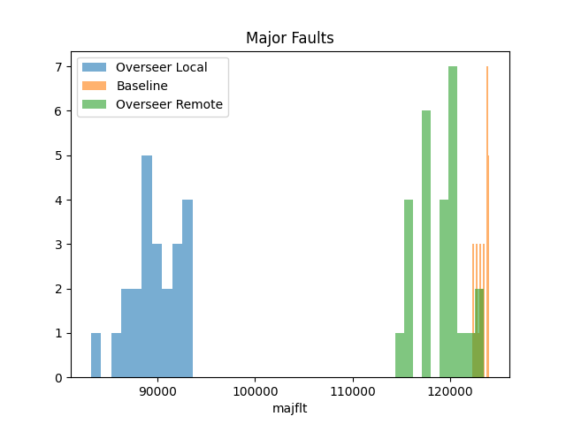

# Overseer

**A neural system for intelligent page prefetching in memory-bound HPC workloads.**

Overseer observes page faults from a running HPC target, predicts which pages the target will fault on next using a transformer model, and prefetches those pages into the target's address space before the faults occur. The prediction runs on a separate inference appliance (a Jetson Orin Nano in our deployment); the observation and enforcement components run on the host, in userspace and kernel space respectively.

## Architecture

Overseer is a three-stage pipeline. The stages are physically and conceptually decoupled and communicate over UDP.

**Collector.** Runs on the same host as the target. Intercepts every userspace page fault in the target's cgroup ([kernel-space BPF program](Daemon/Collector/FaultCollect.bpf.c#L13)) and assembles per-PID sliding windows of 64 recent (instruction pointer, page address) pairs ([userspace handler](Daemon/Collector/main.cpp#L11) and [polling loop](Daemon/Collector/main.cpp#L108)). When a window fills, it is sent to the inference appliance.

**OverNet.** Runs on network-attached inference hardware. Receives a fault window, encodes IPs and pages as ordinal ranks over per-instance delta vocabularies ([encode/decode CUDA kernels](Daemon/OverNet/encode.cu), [LookupTable](Daemon/OverNet/Lookup.cuh#L2)), runs a Transformer encoder-decoder ([training-time model](OverNet/training/OverNet_Ordinal.py#L7), [deployment model with KV-cached decoder](Daemon/OverNet/model/OverNet.py#L127)), and emits a predicted sequence of future page addresses. Predictions are returned to the host over UDP, carrying the originating PID for routing.

**Enforcer.** A kernel module on the target's host. The [dispatcher](Daemon/Enforcer/enforcer.c) receives OverNet's output packets and routes each to a per-PID kernel worker attached to the corresponding process's memory descriptor, spawning a new worker on demand if none exists. Each [worker](Daemon/Enforcer/process_worker.c#L106) forces the predicted pages into residency in the target's address space before the target faults on them.

## Repository layout

Daemon/ Production pipeline running on the target host and the appliance
Collector/ eBPF observation component (host)
OverNet/ Production inference code (appliance)
Enforcer/ Kernel module (host)

OverNet/ Training environment (separate from Daemon/OverNet, which is deployment)
Data/ Benchmark source (Hilbert, matmul), BPF trace-recording scripts,
and utilities to convert traces into binary training tensors
training/ PyTorch model definition, dataloaders, and training scripts

Tests/ Benchmark orchestration: per-workload scripts
([hilbert_test](Tests/orchestrate_hilbert.sh), [matmul_test](Tests/orchestrate_matmul.sh)),
CSV result logging, and metrics.py which produces
the runtime and fault histograms shown above

## Building

All components build from source; there are no prebuilt binaries in the repository. Each component has its own Makefile.

- **Collector**: builds against `libbpf`. Requires kernel headers matching the host kernel.
- **OverNet (production)**: requires CUDA and TensorRT on the inference appliance. The runtime expects a serialized TensorRT engine file, produced from an ONNX export of a trained model.
- **Enforcer**: builds as an out-of-tree kernel module against the running host kernel's headers.

## Running

Running Overseer end-to-end requires:

1. A trained OverNet model. Train in the top-level `OverNet/` environment using PyTorch, then export to ONNX and compile to a TensorRT engine on the inference appliance.
2. The inference appliance running the OverNet daemon and listening for Collector packets.
3. The Enforcer kernel module loaded on the target host.
4. The Collector attached to the target's cgroup, configured with the appliance's IP and port.
5. The Enforcer configured to listen for prediction packets from the appliance.

The scripts in `Tests/` orchestrate all of this for the two benchmark workloads and produce the CSV files consumed by `metrics.py`.

For in Depth instruction see [SETUP.md](SETUP.md)

## Benchmarks

Two workloads are included:

- **Hilbert curve traversal:** spatial locality at short range, data-dependent at longer range. An intermediate operating point for the predictor.
- **Dense matrix multiplication:** blocked matmul over mmap'd operands. Highly regular within blocks with predictable inter-block transitions. A favorable operating point.

Both are memory-bound with working sets that exceed host RAM, so baseline runtime is dominated by major page faults.

## Results

### Matrix Multiplication

On a matmul workload with a working set that exceeds host RAM, Overseer reduces mean runtime from roughly 450 seconds to 50-60 seconds when the inference appliance is local, and to around 120-130 seconds when the appliance is remote. Major page faults drop by more than an order of magnitude in both configurations. The remote configuration paying network and inference-latency costs the local configuration does not, and still landing well below baseline, is direct evidence that the page-fault latency budget can absorb an off-host inference hop.

<table>
  <tr>
    <td></td>
    <td></td>
  </tr>
</table>

### Hilbert curve traversal

The three configurations are cleanly separated on runtime: Baseline clusters at 34–38 seconds, Overseer Remote at 28-30 seconds, and Overseer Local at 22-24 seconds. On major faults, Overseer Local reduces the count from Baseline's ~124K to around 90K per run; Overseer Remote reduces it only marginally, to the 115K–125K range. The runtime improvement is disproportionate to the fault reduction, especially for Remote, which yields a ~19% runtime improvement from only a ~4% fault reduction. On this workload each avoided fault is worth substantially more time than a fault-count ratio would suggest.

<table>
  <tr>
    <td></td>
    <td></td>
  </tr>
</table>
